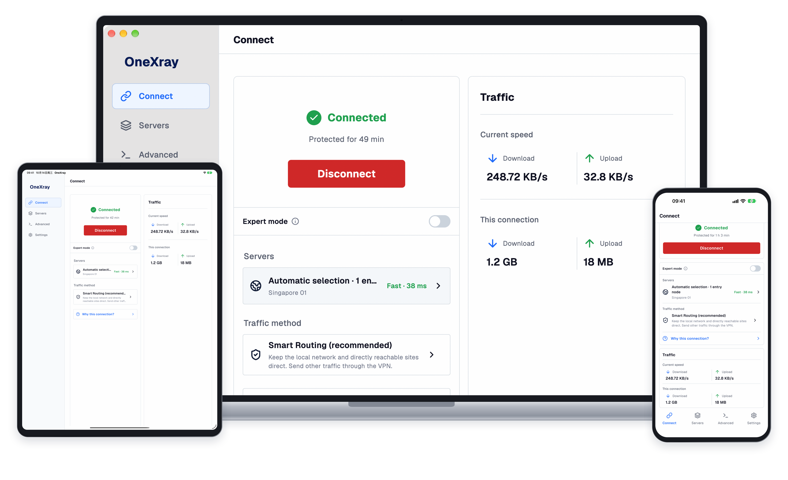

  

<h1 align="center">OneXray</h1>

  An open-source Xray-core client for phones, tablets and desktops.

  English · <a href="./readme/README.zh_CN.md">简体中文</a> · <a href="./readme/README.ru.md">Русский</a>

<strong>Download from the official stores</strong>

  &nbsp;
  &nbsp;
  

  <a href="#linux">Linux</a> · <a href="#onexrayse">OneXraySE</a> · <a href="#other-downloads">Other downloads</a>

  If OneXray is useful to you, give this repository a ⭐ <strong>Star</strong> to support its continued development.

  
  

**Bring your own servers or subscription.** OneXray does not provide VPN access or proxy servers.

## Why OneXray

- **Across your devices.** Use iPhone, iPad, Mac, Android, Windows or Linux, with light/dark themes and five interface languages.
- **Your servers, organized.** Import share links, Xray JSON and subscriptions. Group manual nodes and reorder them by dragging.
- **Routing you control.** Choose Smart or Custom Routing, or use complete Raw and provider configurations, including Remnawave subscriptions.
- **Open and private.** GPL-3.0 source, without accounts, advertising, analytics or tracking. [Privacy policy](https://onexray.com/docs/privacy/).

## Get started

1. Install from the official store and complete setup and system permissions. Windows and Linux also need an outbound-interface selection.
2. Open **Servers** and add your subscription, share links or Xray JSON. Complete provider configurations are recognized during subscription import.
3. On **Connect**, choose a server or complete configuration and start the VPN. For App-managed nodes, Smart Routing is a useful starting point; provider configurations use their own routing and DNS.

[First connection guide](https://onexray.com/docs/getting-started/) · [Import guide](https://onexray.com/docs/servers/import/) · [Remnawave guide](https://onexray.com/docs/servers/remnawave/)

## Download

Choose the official store for your device:

- **iPhone / iPad:** [App Store](https://apps.apple.com/us/app/onexray/id6745748773) — iOS / iPadOS 15+.
- **macOS:** [Mac App Store](https://apps.apple.com/us/app/onexray/id6745748773) — macOS 13+, Apple silicon or Intel.
- **Android phones / tablets:** [Google Play](https://play.google.com/store/apps/details?id=net.yuandev.onexray) — Android 10+, arm64-v8a or x86_64.
- **Windows:** [Microsoft Store](https://apps.microsoft.com/detail/9NJ0MVHW215D) — Windows 10 20H2+ (x64) or Windows 11 (ARM64).

### Linux

[DEB · x86_64](https://github.com/YuanDevTeam/OneXray/releases/latest/download/OneXray-linux-x86_64.deb) · [DEB · arm64](https://github.com/YuanDevTeam/OneXray/releases/latest/download/OneXray-linux-aarch64.deb). Requires Linux 5.3+ and glibc 2.39+. See the [Linux installation guide](https://onexray.com/docs/install/#linux) for dependencies and permissions.

### OneXraySE

The macOS System Extension edition is available through [Homebrew](https://formulae.brew.sh/cask/onexrayse) or [Universal ZIP](https://github.com/YuanDevTeam/OneXray/releases/latest/download/OneXray-macos-universal.zip). Requires macOS 13+, Apple silicon or Intel. Follow the [macOS installation guide](https://onexray.com/docs/install/#macos) for extension approval and updates.

### Other downloads

Direct packages and installation details

| Platform | Packages |
| --- | --- |
| iPhone / iPad | [IPA](https://github.com/YuanDevTeam/OneXray/releases/latest/download/OneXray-ios.ipa) |
| Android | [Universal APK](https://github.com/YuanDevTeam/OneXray/releases/latest/download/OneXray-android-universal.apk) |
| Windows x64 | [EXE via winget](https://onexray.com/docs/install/#windows) · [ZIP](https://github.com/YuanDevTeam/OneXray/releases/latest/download/OneXray-windows-amd64.zip) |
| Windows ARM64 | [EXE via winget](https://onexray.com/docs/install/#windows) · [ZIP](https://github.com/YuanDevTeam/OneXray/releases/latest/download/OneXray-windows-arm64.zip) |
| Linux x86_64 | [ZIP](https://github.com/YuanDevTeam/OneXray/releases/latest/download/OneXray-linux-x86_64.zip) |
| Linux arm64 | [ZIP](https://github.com/YuanDevTeam/OneXray/releases/latest/download/OneXray-linux-aarch64.zip) |

The [installation guide](https://onexray.com/docs/install/) covers IPA signing, Windows editions and separate data locations, ZIP permissions and updates. [All releases](https://github.com/YuanDevTeam/OneXray/releases).

## Configuration and help

- [User documentation](https://onexray.com/docs/) — setup, routing, subscriptions and platform features.
- [Configure with AI](https://onexray.com/docs/ai/) — copy the guide's prompt into an assistant you trust, or attach the [complete guide](https://onexray.com/llms-full.txt). OneXray has no built-in AI service and does not send configurations to an assistant; review generated JSON in the App before connecting.
- [Report a bug or request a feature](https://github.com/YuanDevTeam/OneXray/issues) — include your platform, App/Core versions and reproduction steps. Remove credentials from shared configurations, subscription links and logs.
- [Telegram community](https://t.me/YuanDevTeam).

## Support OneXray

Enjoy OneXray? Give this repository a ⭐ **Star** to support its continued development.

[App Store](https://apps.apple.com/us/app/onexray/id6745748773) · [Google Play](https://play.google.com/store/apps/details?id=net.yuandev.onexray) · [Microsoft Store](https://apps.microsoft.com/detail/9NJ0MVHW215D)

Code, translations and documentation contributions are welcome. Start with the [development setup](./readme/FIRST_RUN.md), [build guide](./build_scripts/README.md) and [App contracts](./docs/README.md).

## License

[GNU General Public License v3.0](./LICENSE).
