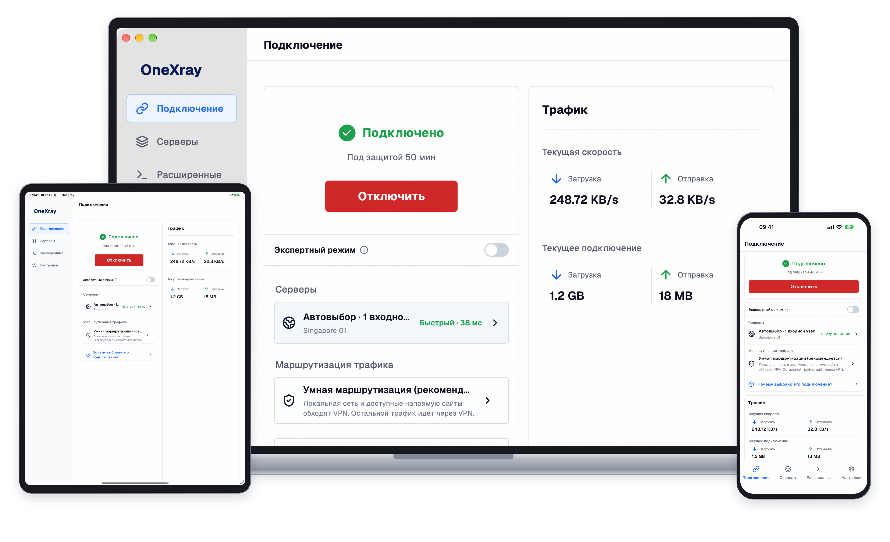

  

<h1 align="center">OneXray</h1>

  Клиент Xray-core с открытым исходным кодом для телефонов, планшетов и компьютеров.

  <a href="../README.md">English</a> · <a href="./README.zh_CN.md">简体中文</a> · Русский

<strong>Скачайте из официальных магазинов</strong>

  &nbsp;
  &nbsp;
  

  <a href="#linux">Linux</a> · <a href="#onexrayse">OneXraySE</a> · <a href="#другие-варианты-загрузки">Другие варианты загрузки</a>

  Если OneXray вам полезен, поставьте этому репозиторию ⭐ <strong>Star</strong>, чтобы поддержать дальнейшую разработку.

  
  

**Добавьте свои серверы или подписку.** OneXray не предоставляет доступ к VPN или прокси-серверы.

## Почему OneXray

- **На всех ваших устройствах.** Используйте iPhone, iPad, Mac, Android, Windows или Linux. Доступны светлая и тёмная темы и пять языков интерфейса.
- **Серверы в порядке.** Импортируйте ссылки, Xray JSON и подписки. Объединяйте вручную добавленные узлы в группы и меняйте их порядок перетаскиванием.
- **Маршрутизация под вашим контролем.** Выбирайте умную или пользовательскую маршрутизацию либо используйте полные конфигурации Raw и провайдеров, включая подписки Remnawave.
- **Открытость и конфиденциальность.** Исходный код под GPL-3.0 с [исключением для VPN-провайдеров](#лицензия), без учётных записей, рекламы, аналитики и отслеживания. [Политика конфиденциальности](https://onexray.com/ru/docs/privacy/).

## Первые шаги

1. Установите приложение из официального магазина, завершите настройку и предоставьте системные разрешения. На Windows и Linux также нужно выбрать исходящий сетевой интерфейс.
2. Откройте **Серверы** и добавьте подписку, ссылки или Xray JSON. Полные конфигурации провайдеров распознаются при импорте подписки.
3. На странице **Подключение** выберите сервер или полную конфигурацию и запустите VPN. Для узлов, которыми управляет приложение, начните с умной маршрутизации; конфигурации провайдеров используют собственные настройки маршрутизации и DNS.

[Первое подключение](https://onexray.com/ru/docs/getting-started/) · [Импорт серверов](https://onexray.com/ru/docs/servers/import/) · [Руководство по Remnawave](https://onexray.com/ru/docs/servers/remnawave/)

## Загрузка

Выберите официальный магазин для своего устройства:

- **iPhone / iPad:** [App Store](https://apps.apple.com/us/app/onexray/id6745748773) — iOS / iPadOS 15+.
- **macOS:** [Mac App Store](https://apps.apple.com/us/app/onexray/id6745748773) — macOS 13+, Apple silicon или Intel.
- **Телефоны / планшеты Android:** [Google Play](https://play.google.com/store/apps/details?id=net.yuandev.onexray) — Android 10+, arm64-v8a или x86_64.
- **Windows:** [Microsoft Store](https://apps.microsoft.com/detail/9NJ0MVHW215D) — Windows 10 20H2+ (x64) или Windows 11 (ARM64).

### Linux

[DEB · x86_64](https://github.com/YuanDevTeam/OneXray/releases/latest/download/OneXray-linux-x86_64.deb) · [DEB · arm64](https://github.com/YuanDevTeam/OneXray/releases/latest/download/OneXray-linux-aarch64.deb). Требуются Linux 5.3+ и glibc 2.39+. Зависимости и разрешения описаны в [руководстве по установке на Linux](https://onexray.com/ru/docs/install/#linux).

### OneXraySE

Версия для macOS с System Extension доступна через [Homebrew](https://formulae.brew.sh/cask/onexrayse) или в виде [Universal ZIP](https://github.com/YuanDevTeam/OneXray/releases/latest/download/OneXray-macos-universal.zip). Требуется macOS 13+, Apple silicon или Intel. Разрешение расширения и обновление описаны в [руководстве по установке на macOS](https://onexray.com/ru/docs/install/#macos).

### Другие варианты загрузки

Пакеты для прямого скачивания и подробности установки

| Платформа | Пакеты |
| --- | --- |
| iPhone / iPad | [IPA](https://github.com/YuanDevTeam/OneXray/releases/latest/download/OneXray-ios.ipa) |
| Android | [Универсальный APK](https://github.com/YuanDevTeam/OneXray/releases/latest/download/OneXray-android-universal.apk) |
| Windows x64 | [EXE через winget](https://onexray.com/ru/docs/install/#windows) · [ZIP](https://github.com/YuanDevTeam/OneXray/releases/latest/download/OneXray-windows-amd64.zip) |
| Windows ARM64 | [EXE через winget](https://onexray.com/ru/docs/install/#windows) · [ZIP](https://github.com/YuanDevTeam/OneXray/releases/latest/download/OneXray-windows-arm64.zip) |
| Linux x86_64 | [ZIP](https://github.com/YuanDevTeam/OneXray/releases/latest/download/OneXray-linux-x86_64.zip) |
| Linux arm64 | [ZIP](https://github.com/YuanDevTeam/OneXray/releases/latest/download/OneXray-linux-aarch64.zip) |

В [руководстве по установке](https://onexray.com/ru/docs/install/) описаны подпись IPA, варианты Windows и отдельное хранение их данных, разрешения и обновление ZIP-версий. [Все релизы](https://github.com/YuanDevTeam/OneXray/releases).

## Настройка и помощь

- [Документация пользователя](https://onexray.com/ru/docs/) — настройка, маршрутизация, подписки и возможности платформ.
- [Настройка с помощью ИИ](https://onexray.com/ru/docs/ai/) — скопируйте запрос из руководства помощнику, которому доверяете, или прикрепите [полное руководство](https://onexray.com/ru/llms-full.txt). OneXray не содержит встроенного ИИ-сервиса и не отправляет конфигурации помощнику; перед подключением проверьте полученный JSON в приложении.
- [Сообщить об ошибке или предложить функцию](https://github.com/YuanDevTeam/OneXray/issues) — укажите платформу, версии приложения и Xray-core, шаги воспроизведения. Удалите учётные данные из публикуемых конфигураций, ссылок подписок и журналов.
- [Сообщество Telegram](https://t.me/YuanDevTeam).

## Поддержать OneXray

OneXray вам полезен? Поставьте этому репозиторию ⭐ **Star**, чтобы поддержать дальнейшую разработку.

[App Store](https://apps.apple.com/us/app/onexray/id6745748773) · [Google Play](https://play.google.com/store/apps/details?id=net.yuandev.onexray) · [Microsoft Store](https://apps.microsoft.com/detail/9NJ0MVHW215D)

Будем рады изменениям кода, переводам и улучшениям документации. Начните с [настройки среды разработки](./FIRST_RUN.ru.md), [руководства по сборке](../build_scripts/README.md) и [правил работы приложения](../docs/README.md).

## Лицензия

OneXray распространяется под [GNU General Public License v3.0](../LICENSE) с [исключением OneXray для VPN-провайдеров](../LICENSE-EXCEPTION).

Провайдеры VPN могут создавать и распространять специализированные клиенты с закрытым исходным кодом для собственных VPN-сервисов, не выполняя требования GPL этого репозитория в отношении кода, на который распространяется исключение. Для других способов использования действуют GPL или иное применимое разрешение.

Yuan Dev Team гарантирует, что не будет добавлять прямые сторонние зависимости, требующие лицензировать соответствующий условиям исключения клиент в целом под GPL или раскрывать его исходный код по GPL. Лицензии сторонних компонентов и относящиеся к ним обязательства сохраняются; исключение охватывает только права, принадлежащие Yuan Dev Team или предоставленные ей для такого лицензирования.

## Деловое сотрудничество

По вопросам делового сотрудничества пишите на [yuan@yuandev.net](mailto:yuan@yuandev.net).
