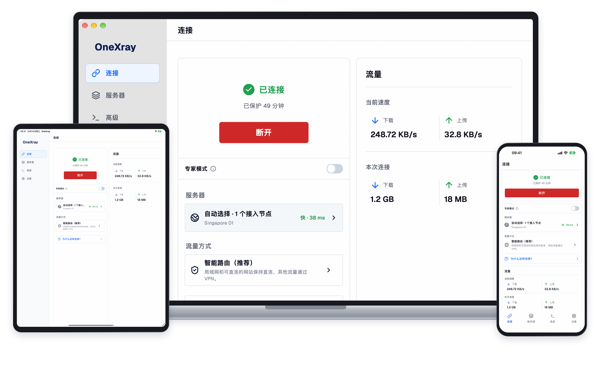

  

<h1 align="center">OneXray</h1>

  适用于手机、平板和桌面的开源 Xray-core 客户端。

  <a href="../README.md">English</a> · 简体中文 · <a href="./README.ru.md">Русский</a>

<strong>从官方商店下载</strong>

  &nbsp;
  &nbsp;
  

  <a href="#linux">Linux</a> · <a href="#onexrayse">OneXraySE</a> · <a href="#其他下载">其他下载</a>

  如果 OneXray 对你有帮助，请为本仓库点亮 ⭐ <strong>Star</strong>，支持项目持续开发。

  
  

**请自备服务器或订阅。** OneXray 不提供 VPN 服务或代理服务器。

## 为什么选择 OneXray

- **跨设备使用。** 支持 iPhone、iPad、Mac、Android、Windows 和 Linux，提供浅色 / 深色主题及五种界面语言。
- **有序管理服务器。** 导入分享链接、Xray JSON 和订阅；将手动节点整理为分组，并通过拖动调整顺序。
- **自主控制路由。** 使用智能路由或自定义路由，也可使用完整 Raw 配置和服务商配置，包括 Remnawave 订阅。
- **开源，保护隐私。** 源码采用 GPL-3.0 许可，无需账户，不含广告、分析或跟踪。[隐私政策](https://onexray.com/zh/docs/privacy/)。

## 快速开始

1. 从官方商店安装，完成初始化并授予所需的系统权限。Windows 和 Linux 还需要选择出口网卡。
2. 打开“**服务器**”，添加订阅、分享链接或 Xray JSON。导入订阅时会自动识别服务商的完整配置。
3. 在“**连接**”页选择服务器或完整配置，然后启动 VPN。App 管理的节点可先使用智能路由；服务商配置使用自身的路由和 DNS。

[首次连接指南](https://onexray.com/zh/docs/getting-started/) · [导入指南](https://onexray.com/zh/docs/servers/import/) · [Remnawave 指南](https://onexray.com/zh/docs/servers/remnawave/)

## 下载

选择适合设备的官方商店：

- **iPhone / iPad：** [App Store](https://apps.apple.com/us/app/onexray/id6745748773) — iOS / iPadOS 15+。
- **macOS：** [Mac App Store](https://apps.apple.com/us/app/onexray/id6745748773) — macOS 13+，Apple silicon 或 Intel。
- **Android 手机 / 平板：** [Google Play](https://play.google.com/store/apps/details?id=net.yuandev.onexray) — Android 10+，arm64-v8a 或 x86_64。
- **Windows：** [Microsoft Store](https://apps.microsoft.com/detail/9NJ0MVHW215D) — Windows 10 20H2+（x64）或 Windows 11（ARM64）。

### Linux

[DEB · x86_64](https://github.com/YuanDevTeam/OneXray/releases/latest/download/OneXray-linux-x86_64.deb) · [DEB · arm64](https://github.com/YuanDevTeam/OneXray/releases/latest/download/OneXray-linux-aarch64.deb)。需要 Linux 5.3+ 和 glibc 2.39+。依赖与权限要求见 [Linux 安装指南](https://onexray.com/zh/docs/install/#linux)。

### OneXraySE

macOS System Extension 版本可通过 [Homebrew](https://formulae.brew.sh/cask/onexrayse) 或 [Universal ZIP](https://github.com/YuanDevTeam/OneXray/releases/latest/download/OneXray-macos-universal.zip) 安装。需要 macOS 13+，支持 Apple silicon 和 Intel。扩展授权与更新步骤见 [macOS 安装指南](https://onexray.com/zh/docs/install/#macos)。

### 其他下载

直接下载安装包与安装说明

| 平台 | 安装包 |
| --- | --- |
| iPhone / iPad | [IPA](https://github.com/YuanDevTeam/OneXray/releases/latest/download/OneXray-ios.ipa) |
| Android | [通用 APK](https://github.com/YuanDevTeam/OneXray/releases/latest/download/OneXray-android-universal.apk) |
| Windows x64 | [通过 winget 安装 EXE](https://onexray.com/zh/docs/install/#windows) · [ZIP](https://github.com/YuanDevTeam/OneXray/releases/latest/download/OneXray-windows-amd64.zip) |
| Windows ARM64 | [通过 winget 安装 EXE](https://onexray.com/zh/docs/install/#windows) · [ZIP](https://github.com/YuanDevTeam/OneXray/releases/latest/download/OneXray-windows-arm64.zip) |
| Linux x86_64 | [ZIP](https://github.com/YuanDevTeam/OneXray/releases/latest/download/OneXray-linux-x86_64.zip) |
| Linux arm64 | [ZIP](https://github.com/YuanDevTeam/OneXray/releases/latest/download/OneXray-linux-aarch64.zip) |

[安装指南](https://onexray.com/zh/docs/install/)涵盖 IPA 签名、Windows 版本与独立数据目录、ZIP 权限及更新方式。[查看所有版本](https://github.com/YuanDevTeam/OneXray/releases)。

## 配置与帮助

- [使用文档](https://onexray.com/zh/docs/) — 初始化、路由、订阅与平台功能。
- [使用 AI 配置](https://onexray.com/zh/docs/ai/) — 将指南中的提示词复制给你信任的 AI 助手，或附上[完整指南](https://onexray.com/zh/llms-full.txt)。OneXray 不内置 AI 服务，也不会向助手发送配置；连接前请在 App 中检查生成的 JSON。
- [反馈问题或提出功能建议](https://github.com/YuanDevTeam/OneXray/issues) — 请附上平台、App / Core 版本和复现步骤。分享配置、订阅链接和日志前，请移除凭据。
- [Telegram 社区](https://t.me/YuanDevTeam)。

## 支持 OneXray

喜欢 OneXray？请为本仓库点亮 ⭐ **Star**，支持项目持续开发。

[App Store](https://apps.apple.com/us/app/onexray/id6745748773) · [Google Play](https://play.google.com/store/apps/details?id=net.yuandev.onexray) · [Microsoft Store](https://apps.microsoft.com/detail/9NJ0MVHW215D)

欢迎贡献代码、翻译和文档。请从[开发环境配置](./FIRST_RUN.zh_CN.md)、[构建指南](../build_scripts/README.md)和 [App 行为约定](../docs/README.md)开始。

## 许可证

[GNU General Public License v3.0](../LICENSE)。
